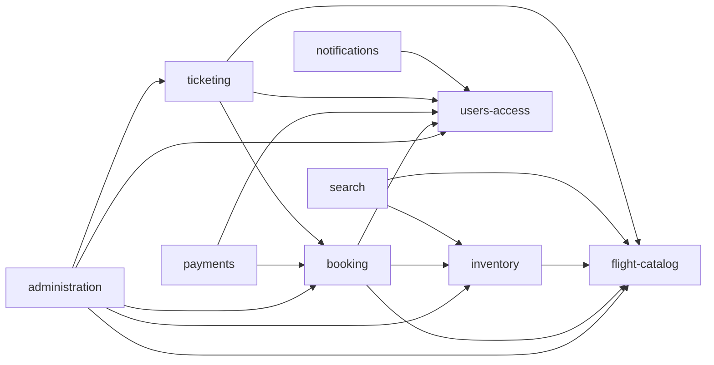

# Flight Search, Booking and Ticketing System

A Software Construction and Testing team project (GIU, Winter 2026): flight search and comparison,
seat inventory, booking, simulated payment, e-tickets, notifications and an administration back
office. It is built as a modular monolith:

- `apps/api`: one NestJS backend that contains all nine domain modules.
- `apps/web`: one Next.js frontend. The frontend is not part of Milestone 2.
- One PostgreSQL 18 database.

## Contents

- [Milestone 2 at a glance](#milestone-2-at-a-glance)
- [Run the demo](#run-the-demo)
- [Backend functionality](#backend-functionality)
- [API demonstration](#api-demonstration)
- [Architecture alignment](#architecture-alignment)
- [Design patterns](#design-patterns)
- [Code quality and programming paradigms](#code-quality-and-programming-paradigms)
- [Individual questions: who built what](#individual-questions-who-built-what)
- [Setup from a fresh clone](#setup-from-a-fresh-clone), [Scripts](#scripts),
  [Repository layout](#repository-layout), [Modules](#modules), [Module rules](#module-rules)

## Milestone 2 at a glance

| Criterion                              | Evidence                                                                                                                                                        |
| -------------------------------------- | --------------------------------------------------------------------------------------------------------------------------------------------------------------- |
| Backend functionality                  | Nine modules, 54 user stories and 19 NFRs registered in [`docs/traceability.json`](docs/traceability.json), each with at least one test. CI is green on `main`. |
| API demonstration                      | Swagger UI at `/docs` documents every route with examples; a [Postman collection](docs/postman/) of 65 requests runs the whole journey with 78 assertions.      |
| Architecture alignment                 | Modular monolith; each module's `index.ts` is its only public door, enforced in CI by dependency-cruiser. Modules talk through interfaces and domain events.    |
| Code quality and programming paradigms | Six design patterns from the lecture (Topics 5 and 6), each with the lecture's roles; OOP, functional and declarative code; a complexity limit of 10.           |
| Individual questions                   | Every module has an owner, a README and its pull requests, listed [below](#individual-questions-who-built-what).                                                |

## Run the demo

Requirements: Node.js 24, pnpm 12 and Docker (see [Prerequisites](#prerequisites)).

```sh
pnpm install
pnpm bootstrap   # .env files, PostgreSQL in Docker, migrations, demo accounts and flights
pnpm dev         # API on http://localhost:3001, web on http://localhost:3000
```

| What       | Where                                                                    |
| ---------- | ------------------------------------------------------------------------ |
| Swagger UI | <http://localhost:3001/docs>                                             |
| Postman    | import both files in [`docs/postman/`](docs/postman/README.md)           |
| Health     | <http://localhost:3001/health>                                           |
| Admin      | `admin@example.com` / `Admin-Local-2026!` (local development only)       |
| Traveler   | `traveler@example.com` / `Traveler-Local-2026!` (local development only) |

The first bootstrap seeds about 52,000 flights between 1,168 real airports and takes a few
minutes ([Demo data](#demo-data)). Bootstrap once before presenting, or set `SEED_WORLD=false` for
the 15 hand-written routes only.

## Backend functionality

Every module below is implemented, merged and covered by unit and integration tests (537 unit
tests, 401 integration tests against a real PostgreSQL).

| Module                                                          | What works                                                                                                                                                                                                               |
| --------------------------------------------------------------- | ------------------------------------------------------------------------------------------------------------------------------------------------------------------------------------------------------------------------ |
| [Users and Access](apps/api/src/modules/users-access/README.md) | Register, sign in and out with an HttpOnly session cookie, profile, password change, saved travelers, roles (traveler, administrator), ownership checks, CSRF header check.                                              |
| [Flight Catalog](apps/api/src/modules/flight-catalog/README.md) | Flights, airports, airlines, schedules stored in UTC and shown in airport-local time, fares in integer minor units, flight status rules, party pricing.                                                                  |
| [Search](apps/api/src/modules/search/README.md)                 | One-way and round-trip search by the origin's local date, four sort orders, filters by price, departure window and airline, paging, only flights with enough seats.                                                      |
| [Inventory](apps/api/src/modules/inventory/README.md)           | Cabin capacity, real-time availability, transactional seat holds that never oversell, hold expiry, commit on payment, release exactly once.                                                                              |
| [Booking](apps/api/src/modules/booking/README.md)               | Multi-passenger and round-trip bookings at the displayed price, idempotency keys, a 15-minute payment window, the booking lifecycle (State), cancellation with the 24-hour rule.                                         |
| [Payments](apps/api/src/modules/payments/README.md)             | Simulated card payments through a gateway Adapter, idempotent charges, declines and retries, receipts, refunds on cancellation, recovery of interrupted payments.                                                        |
| [Ticketing](apps/api/src/modules/ticketing/README.md)           | E-tickets issued after payment, one per passenger per flight (Factory Method), 13-digit ticket numbers, printable e-ticket, voiding on cancellation, a repair job for missed issues.                                     |
| [Notifications](apps/api/src/modules/notifications/README.md)   | In-app notifications from domain events (confirmed, ticketed, expired, cancelled, flight delayed or cancelled), departure reminders the day before each leg, email for the types a traveler opts into, inbox, mark read. |
| [Administration](apps/api/src/modules/administration/README.md) | Create flights and recurring series, capacity, fares, flight status (delay, cancel, with knock-on cancellations and refunds), airports, a second administrator, manifest, audit trail.                                   |

## API demonstration

- **Swagger:** every route is documented with its request body, responses, error codes and real
  examples recorded from a Postman run. Protected routes show the `flight_session` cookie as
  their security scheme. Tests (NFR-ERR-01-T08 to T11) fail the build if a route is
  undocumented.
- **Postman:** [`docs/postman/`](docs/postman/README.md) holds the collection and a local
  environment. Its folders follow a demo, and each request passes the IDs it receives to the
  next:

  1. Health and reference data
  2. Administration: schedule a flight
  3. Search and comparison
  4. Account (Users and Access)
  5. Booking and payment
  6. Tickets
  7. Administration: operate
  8. Cancellation
  9. Notifications

  ```sh
  npx newman run docs/postman/flight-booking-api.postman_collection.json -e docs/postman/local.postman_environment.json
  ```

- **Data:** the bootstrap seeds a world network so any search returns real-looking results. Over
  HTTP, 300 searches against 52,186 flights measured p50 about 5 ms and p95 6 to 8 ms locally.

State-changing requests need the `X-Requested-With` header (CSRF protection). The Postman
collection sends it; in Swagger it is sent for you.

## Architecture alignment

The system is the modular monolith proposed for the project: one deployable backend, one
database, and nine modules that are vertical slices of the domain.



_Arrows are compile-time imports through `index.ts`. Domain events flow the other way without
imports: Booking, Payments, Ticketing and Administration publish; Notifications, Ticketing and
Payments observe._

- **One public door per module.** A module's `index.ts` exports an interface and an injection
  token; everything else is private. [dependency-cruiser](.dependency-cruiser.cjs) fails CI on any
  import that bypasses it, on cycles, and on `shared/` importing a module ([rules](#module-rules)).
  Notifications, as its pack says, calls into no domain module at all: a rule
  (`notifications-only-listens`) fails CI if it does.
- **Data ownership.** Each module owns its tables and registers only its own entities. Another
  module's data is referenced by a plain ID, never a TypeORM relation.
- **Events instead of calls back.** A module that must react to another publishes or observes a
  domain event ([`shared/events.ts`](apps/api/src/shared/events.ts)). After-commit events
  (`BookingConfirmed`, `TicketsIssued`, ...) never announce a rolled-back change; a few
  in-transaction events (voiding tickets and recording refunds when a booking is cancelled) keep
  those writes atomic.
- **Consistency where it matters.** Seat holds lock the cabin row; a booking, its holds and its
  history commit together; holds on a round trip are taken in flight-ID order to avoid deadlocks.
- **Schema by migration only.** `synchronize` is off; every table comes from a reviewed migration
  in [`apps/api/src/database/migrations`](apps/api/src/database/migrations).
- **Sessions.** An opaque server-side session in an HttpOnly, SameSite=Lax cookie with a sliding
  24-hour expiry, so a stolen token cannot be read by scripts and a session can be revoked.

## Design patterns

Every pattern below is from the lecture (Topics 5 and 6: creational, structural and behavioural),
and each table names the lecture's roles and the class that plays them. Click a file to open it.

| Pattern                                        | Kind        | Module                  | Where to look                                                                                                                                                   |
| ---------------------------------------------- | ----------- | ----------------------- | --------------------------------------------------------------------------------------------------------------------------------------------------------------- |
| [Factory Method](#factory-method-ticketing)    | Creational  | Ticketing               | [`ticket-creator.ts`](apps/api/src/modules/ticketing/ticket-creator.ts), [`ticket.ts`](apps/api/src/modules/ticketing/ticket.ts)                                |
| [Adapter](#adapter-payments-and-notifications) | Structural  | Payments, Notifications | [`gateway/`](apps/api/src/modules/payments/gateway/), [`users-email-directory.adapter.ts`](apps/api/src/modules/notifications/users-email-directory.adapter.ts) |
| [Decorator](#decorator-users-and-access)       | Structural  | Users and Access        | [`access.ts`](apps/api/src/modules/users-access/access.ts)                                                                                                      |
| [Command](#command-administration)             | Behavioural | Administration          | [`admin-command.ts`](apps/api/src/modules/administration/admin-command.ts), [`command-bus.ts`](apps/api/src/modules/administration/command-bus.ts)              |
| [Strategy](#strategy-search)                   | Behavioural | Search                  | [`sorting/`](apps/api/src/modules/search/sorting/)                                                                                                              |
| [Observer](#observer-domain-events)            | Behavioural | Cross-module            | [`shared/events.ts`](apps/api/src/shared/events.ts), [`notification-event.handler.ts`](apps/api/src/modules/notifications/notification-event.handler.ts)        |

### Factory Method (Ticketing)

Ticketing must create one ticket per passenger per flight without the issuing workflow knowing
which kind of ticket it makes.

| Lecture role    | Here                                                                                                                                                      |
| --------------- | --------------------------------------------------------------------------------------------------------------------------------------------------------- |
| IProduct        | [`Ticket`](apps/api/src/modules/ticketing/ticket.ts)                                                                                                      |
| ConcreteProduct | [`ETicket`](apps/api/src/modules/ticketing/ticket.ts)                                                                                                     |
| Creator         | [`TicketCreator`](apps/api/src/modules/ticketing/ticket-creator.ts), whose `forBooking` (SomeOperation) calls the factory method per passenger and flight |
| ConcreteCreator | [`ETicketCreator`](apps/api/src/modules/ticketing/ticket-creator.ts), whose `createTicket` is the factory method                                          |
| Client          | [`IssueTickets`](apps/api/src/modules/ticketing/issue-tickets.ts), which depends only on `TicketCreator`                                                  |

[`ticketing.module.ts`](apps/api/src/modules/ticketing/ticketing.module.ts) binds
`TicketCreator` to `ETicketCreator`. A boarding pass or a paper ticket would be a new product and a
new creator, with no change to `IssueTickets`. Built in
[#19](https://github.com/Yassin-Hegazy/flight-system/pull/19).

### Adapter (Payments and Notifications)

Payments talks to a payment provider whose interface is not ours. The Adapter was built across two
pull requests: [#13](https://github.com/Yassin-Hegazy/flight-system/pull/13) introduced the
`PaymentGateway` interface and `MockGatewayAdapter`, and
[#17](https://github.com/Yassin-Hegazy/flight-system/pull/17) split the simulated provider out as
the Adaptee, so every lecture role is its own class.

| Lecture role | Here                                                                                                                                                                                                                                                  |
| ------------ | ----------------------------------------------------------------------------------------------------------------------------------------------------------------------------------------------------------------------------------------------------- |
| Target       | [`PaymentGateway`](apps/api/src/modules/payments/gateway/payment-gateway.ts): `charge`, `lookup`, `refund`, in our terms                                                                                                                              |
| Adaptee      | [`MockProvider`](apps/api/src/modules/payments/gateway/mock-provider.ts): a simulated provider with its own API (`createPayment`, `retrievePayment`, `createRefund`) and its own errors (`ProviderTimeout`)                                           |
| Adapter      | [`MockGatewayAdapter`](apps/api/src/modules/payments/gateway/mock-gateway.adapter.ts): implements `PaymentGateway` by translating each call and each result to and from `MockProvider`                                                                |
| Client       | [`PayForBooking`](apps/api/src/modules/payments/pay-for-booking.ts), [`RefundPayments`](apps/api/src/modules/payments/refund-payments.ts) and [`RecoverPayments`](apps/api/src/modules/payments/recover-payments.ts), which see only `PaymentGateway` |

A real provider (Stripe, Paymob) would be one new adapter and one line in
[`payments.module.ts`](apps/api/src/modules/payments/payments.module.ts).

Notifications uses the same pattern for the one thing it needs from another module, an email
address. It defines the interface it wants (the Target),
[`EmailDirectory`](apps/api/src/modules/notifications/email-directory.ts), and
[`UsersEmailDirectoryAdapter`](apps/api/src/modules/notifications/users-email-directory.adapter.ts)
translates Users and Access (the Adaptee) into it for the email channel (the Client).

### Decorator (Users and Access)

Access rules (signed in, has a role, owns the resource) wrap a use case instead of being repeated
inside it, and stack in any order.

| Lecture role      | Here                                                                                                     |
| ----------------- | -------------------------------------------------------------------------------------------------------- |
| IComponent        | [`UseCase<I, O>`](apps/api/src/modules/users-access/access.ts), with one method `execute(ctx, input)`    |
| ConcreteComponent | [`Action`](apps/api/src/modules/users-access/access.ts), or any class that implements `UseCase`          |
| Decorator         | [`UseCaseDecorator`](apps/api/src/modules/users-access/access.ts): holds a component and delegates to it |
| ConcreteDecorator | [`WithAuth`, `WithRole`, `WithOwnership`](apps/api/src/modules/users-access/access.ts): one check each   |

```ts
const createFlight = new WithAuth(new WithRole(createFlightCommand, UserRole.Admin));
```

Before any decorator runs, a Nest guard makes the coarse check
([`SignedInGuard`, `AdminGuard`](apps/api/src/modules/users-access/access.ts)), so an anonymous
caller gets 401 and a traveler 403 before the request body is even validated. The decorators then
make the precise check, such as ownership.

Built in [#1](https://github.com/Yassin-Hegazy/flight-system/pull/1) and aligned with the lecture in
[#4](https://github.com/Yassin-Hegazy/flight-system/pull/4).

### Command (Administration)

Every administrative operation is an object, so authorization, the transaction, the audit entry
and event publishing are written once for all of them.

| Lecture role    | Here                                                                                                                                                                                                                                                                                                                                                                                                                                                                                                                                                                                                                     |
| --------------- | ------------------------------------------------------------------------------------------------------------------------------------------------------------------------------------------------------------------------------------------------------------------------------------------------------------------------------------------------------------------------------------------------------------------------------------------------------------------------------------------------------------------------------------------------------------------------------------------------------------------------ |
| ICommand        | [`AdminCommand`](apps/api/src/modules/administration/admin-command.ts): `name` and `execute(tx)`                                                                                                                                                                                                                                                                                                                                                                                                                                                                                                                         |
| ConcreteCommand | [`CreateFlight`](apps/api/src/modules/administration/create-flight.command.ts), [`ScheduleRecurring`](apps/api/src/modules/administration/schedule-recurring.command.ts), [`UpdateFlightStatus`](apps/api/src/modules/administration/update-flight-status.command.ts), [`CancelFlight`](apps/api/src/modules/administration/cancel-flight.command.ts), [`ConfigureCapacity`](apps/api/src/modules/administration/configure-capacity.command.ts), [`UpdateFare`](apps/api/src/modules/administration/update-fare.command.ts), [`UpsertAirport`, `DeleteAirport`](apps/api/src/modules/administration/airport.commands.ts) |
| Invoker         | [`CommandBus`](apps/api/src/modules/administration/command-bus.ts): checks the administrator role, opens the transaction, writes the audit log, publishes events after commit                                                                                                                                                                                                                                                                                                                                                                                                                                            |
| Receiver        | The Catalog, Inventory and Booking APIs each command is built with                                                                                                                                                                                                                                                                                                                                                                                                                                                                                                                                                       |
| Client          | [`AdministrationController`](apps/api/src/modules/administration/administration.controller.ts) and [`AdministrationOperationsController`](apps/api/src/modules/administration/administration-operations.controller.ts), which build a command and hand it to the bus                                                                                                                                                                                                                                                                                                                                                     |

Built in [#12](https://github.com/Yassin-Hegazy/flight-system/pull/12),
[#15](https://github.com/Yassin-Hegazy/flight-system/pull/15) and
[#18](https://github.com/Yassin-Hegazy/flight-system/pull/18).

### Strategy (Search)

The four sort orders are interchangeable algorithms chosen at run time by the `sort` query
parameter.

| Lecture role     | Here                                                                                                                                                                                                                                                                                                                                                                           |
| ---------------- | ------------------------------------------------------------------------------------------------------------------------------------------------------------------------------------------------------------------------------------------------------------------------------------------------------------------------------------------------------------------------------ |
| Strategy         | [`SortStrategy`](apps/api/src/modules/search/sorting/sort-strategy.ts): `key` and `compare(a, b)`                                                                                                                                                                                                                                                                              |
| ConcreteStrategy | [`PriceSortStrategy`](apps/api/src/modules/search/sorting/price-sort.strategy.ts), [`DurationSortStrategy`](apps/api/src/modules/search/sorting/duration-sort.strategy.ts), [`DepartureTimeSortStrategy`](apps/api/src/modules/search/sorting/departure-time-sort.strategy.ts), [`ArrivalTimeSortStrategy`](apps/api/src/modules/search/sorting/arrival-time-sort.strategy.ts) |
| Context          | [`SearchOneWay`](apps/api/src/modules/search/search-one-way.ts), which only calls `compare` on the strategy the [registry](apps/api/src/modules/search/sorting/sort-registry.ts) returns                                                                                                                                                                                       |

A new sort order is one class and one line in
[`search.module.ts`](apps/api/src/modules/search/search.module.ts). Built in
[#16](https://github.com/Yassin-Hegazy/flight-system/pull/16).

### Observer (domain events)

Modules learn what happened elsewhere without depending on the module where it happened.

| Lecture role     | Here                                                                                                                                                                                                                                                                                                                                                                                                                                       |
| ---------------- | ------------------------------------------------------------------------------------------------------------------------------------------------------------------------------------------------------------------------------------------------------------------------------------------------------------------------------------------------------------------------------------------------------------------------------------------ |
| Subject          | The application's event emitter, reached through [`publishDomainEvent`](apps/api/src/shared/events.ts)                                                                                                                                                                                                                                                                                                                                     |
| ConcreteSubject  | The publishers: Booking, Payments, Ticketing and Administration (through `CommandBus`)                                                                                                                                                                                                                                                                                                                                                     |
| Observer         | A handler for an event type in [`shared/events.ts`](apps/api/src/shared/events.ts)                                                                                                                                                                                                                                                                                                                                                         |
| ConcreteObserver | [`NotificationEventHandler`](apps/api/src/modules/notifications/notification-event.handler.ts), [`DepartureTracker`](apps/api/src/modules/notifications/departure-tracker.ts) (reminders), [`IssueTickets`](apps/api/src/modules/ticketing/issue-tickets.ts) (`BookingConfirmed`), [`VoidTickets`](apps/api/src/modules/ticketing/void-tickets.ts) and [`RefundPayments`](apps/api/src/modules/payments/refund-payments.ts) (cancellation) |

Publishers never import Notifications, so adding a notification never touches the module that
caused it. Built in [#9](https://github.com/Yassin-Hegazy/flight-system/pull/9).

### Also in the code

These structures appear in the code but are not among the lecture's patterns; their modules'
READMEs explain them:

- **State**: the booking lifecycle in [`booking-state.ts`](apps/api/src/modules/booking/booking-state.ts).
- **Facade**: [`InventoryFacade`](apps/api/src/modules/inventory/inventory.facade.ts) and
  [`SearchFacade`](apps/api/src/modules/search/search.facade.ts), each module's single entry point.
- **Repository**: [`CatalogRepository`](apps/api/src/modules/flight-catalog/catalog.repository.ts)
  and the Notifications repositories, which hide SQL behind an interface.

## Code quality and programming paradigms

- **Object-oriented:** the patterns above; interfaces with injection tokens as every module's
  boundary; behaviour kept next to its data (`Flight.schedule` validates a flight, each booking
  state class allows only its own moves).
- **SOLID in practice:**
  - Single responsibility: one use case per class (`CreateBooking`, `PayForBooking`,
    `IssueTickets`).
  - Open/closed: a new sort order, ticket type, payment provider or admin command is a new class,
    not an edit.
  - Liskov: every decorator is a `UseCase` and every adapter a `PaymentGateway`.
  - Interface segregation: Booking exposes narrow interfaces per consumer (`BOOKING_PAYMENTS`,
    `BOOKING_TICKETING`, ...).
  - Dependency inversion: modules depend on interfaces and tokens, never on another module's
    classes.
- **Functional:** expected failures are values, not exceptions
  ([`Result`](apps/api/src/shared/result.ts)); money is an immutable value in integer minor units
  ([`money.ts`](apps/api/src/shared/money.ts)); search filters are pure predicates composed with
  `every` and `some`; the seed's schedule generator is a pure function.
- **Declarative and imperative:** passenger rules and search filters declare what is valid;
  `CreateBooking` is an explicit sequence where order matters (replay check, cheap rules, then
  the atomic write).
- **Event-driven:** cross-module reactions go through domain events (Observer).
- **Enforced in CI on every pull request:** strict TypeScript, ESLint with a cyclomatic
  complexity limit of 10, Prettier, dependency-cruiser, the traceability check, and the unit,
  integration and Playwright suites.
- **Test-first history:** most features were committed as a failing test, then the code that
  makes it pass; test names start with their requirement ID (for example `US-PAY-01-T03`).

## Individual questions: who built what

| Module           | Built by                                                                                                         | Pull requests                                                                                                                                                                                                                                                                                                     |
| ---------------- | ---------------------------------------------------------------------------------------------------------------- | ----------------------------------------------------------------------------------------------------------------------------------------------------------------------------------------------------------------------------------------------------------------------------------------------------------------- |
| Users and Access | [AbdallahMahmoud2006](https://github.com/AbdallahMahmoud2006), [Yassin-Hegazy](https://github.com/Yassin-Hegazy) | [#1](https://github.com/Yassin-Hegazy/flight-system/pull/1), [#4](https://github.com/Yassin-Hegazy/flight-system/pull/4)                                                                                                                                                                                          |
| Flight Catalog   | [AbdallahMahmoud2006](https://github.com/AbdallahMahmoud2006)                                                    | [#2](https://github.com/Yassin-Hegazy/flight-system/pull/2)                                                                                                                                                                                                                                                       |
| Inventory        | [MohamedWalid16006402](https://github.com/MohamedWalid16006402)                                                  | [#3](https://github.com/Yassin-Hegazy/flight-system/pull/3), [#5](https://github.com/Yassin-Hegazy/flight-system/pull/5), [#6](https://github.com/Yassin-Hegazy/flight-system/pull/6), [#7](https://github.com/Yassin-Hegazy/flight-system/pull/7), [#10](https://github.com/Yassin-Hegazy/flight-system/pull/10) |
| Notifications    | [ZeyadAmr-16005823](https://github.com/ZeyadAmr-16005823)                                                        | [#9](https://github.com/Yassin-Hegazy/flight-system/pull/9)                                                                                                                                                                                                                                                       |
| Search           | [youssefkhaleel0689](https://github.com/youssefkhaleel0689)                                                      | [#16](https://github.com/Yassin-Hegazy/flight-system/pull/16)                                                                                                                                                                                                                                                     |
| Booking          | [Abdelrahman-khaled16009599](https://github.com/Abdelrahman-khaled16009599)                                      | [#22](https://github.com/Yassin-Hegazy/flight-system/pull/22), [#23](https://github.com/Yassin-Hegazy/flight-system/pull/23)                                                                                                                                                                                      |
| Administration   | [Yassin-Hegazy](https://github.com/Yassin-Hegazy)                                                                | [#12](https://github.com/Yassin-Hegazy/flight-system/pull/12), [#15](https://github.com/Yassin-Hegazy/flight-system/pull/15), [#18](https://github.com/Yassin-Hegazy/flight-system/pull/18)                                                                                                                       |
| Payments         | [Yassin-Hegazy](https://github.com/Yassin-Hegazy)                                                                | [#13](https://github.com/Yassin-Hegazy/flight-system/pull/13), [#14](https://github.com/Yassin-Hegazy/flight-system/pull/14), [#17](https://github.com/Yassin-Hegazy/flight-system/pull/17)                                                                                                                       |
| Ticketing        | [Yassin-Hegazy](https://github.com/Yassin-Hegazy)                                                                | [#19](https://github.com/Yassin-Hegazy/flight-system/pull/19), [#21](https://github.com/Yassin-Hegazy/flight-system/pull/21)                                                                                                                                                                                      |
| Platform         | [Yassin-Hegazy](https://github.com/Yassin-Hegazy) (lead)                                                         | Repository setup, CI and architecture rules, Swagger and Postman ([#20](https://github.com/Yassin-Hegazy/flight-system/pull/20)), world demo data ([#24](https://github.com/Yassin-Hegazy/flight-system/pull/24))                                                                                                 |

Each module's README covers its public API, how it is built and its tests: the place to prepare
for questions about your own part.

## Prerequisites

| Tool    | Version                                      | Notes                                                               |
| ------- | -------------------------------------------- | ------------------------------------------------------------------- |
| Node.js | 24 LTS, 24.15.0 or later (see `.nvmrc`)      | `nvm use` or `fnm use` selects the pinned version.                  |
| pnpm    | 12 (pinned in `package.json`)                | Install with `npm install -g pnpm@12` or `corepack enable`.         |
| Docker  | Docker Desktop or Docker Engine with Compose | Runs the local database and the integration tests (Testcontainers). |

## Setup from a fresh clone

```sh
pnpm install
docker compose up -d
cp apps/api/.env.example apps/api/.env
cp apps/web/.env.example apps/web/.env
pnpm dev
```

On Windows PowerShell, use `Copy-Item` in place of `cp`.

Then open:

- <http://localhost:3000>: the web app. It shows the API health, which should read "Database connected".
- <http://localhost:3001/docs>: the API documentation (Swagger UI).

### Demo data

`pnpm bootstrap` seeds an administrator, a demo traveler and a world flight network: 1,168 real
airports in 233 countries and territories, and about 52,000 flights over the next 14 days. Hubs
fly to each other daily; every other airport links to its three nearest hubs three times a week,
with a return after each arrival. It goes through the Catalog and Inventory APIs and takes about
2.5 minutes on a 2-core machine; a re-run only counts what is already there. Set
`SEED_WORLD=false` to seed just the 15 hand-written demo routes.

The airports are real; the schedules and fares are generated. Airport data comes from
[OurAirports](https://ourairports.com/data/) (public domain) and time zones from
[OpenFlights](https://openflights.org/data.html) (Open Database License).

To run the Playwright tests for the first time, install the browsers once:

```sh
pnpm --filter web exec playwright install chromium firefox
```

## Scripts

Run every script from the repository root.

| Script                       | What it does                                                                                                                                                          |
| ---------------------------- | --------------------------------------------------------------------------------------------------------------------------------------------------------------------- |
| `pnpm dev`                   | Starts both apps in watch mode: web on port 3000, API on port 3001.                                                                                                   |
| `pnpm build`                 | Builds both apps for production.                                                                                                                                      |
| `pnpm typecheck`             | Type-checks both apps with TypeScript. Requires `apps/web/.env`, because Next.js reads `API_URL`.                                                                     |
| `pnpm lint`                  | Runs ESLint on the whole repository. `pnpm lint:fix` also applies automatic fixes.                                                                                    |
| `pnpm format`                | Formats the whole repository with Prettier. `pnpm format:check` only reports differences.                                                                             |
| `pnpm depcruise`             | Checks the architecture rules (see [Module rules](#module-rules)) with dependency-cruiser.                                                                            |
| `pnpm test`                  | Runs the API unit tests (`*.spec.ts` under `apps/api/src`) with coverage.                                                                                             |
| `pnpm test:integration`      | Runs the API integration tests (`apps/api/test/**/*.int-spec.ts`) against a PostgreSQL container started by Testcontainers. Docker must be running.                   |
| `pnpm test:e2e`              | Runs the Playwright tests in Chromium and Firefox. Starts both apps if they are not already running; the database must be running.                                    |
| `pnpm db:migration:generate` | Generates a migration from the difference between the entities and the database. Pass the path, e.g. `pnpm db:migration:generate src/database/migrations/AddFlights`. |
| `pnpm db:migration:create`   | Creates an empty migration. Pass the path, e.g. `pnpm db:migration:create src/database/migrations/SeedAirports`.                                                      |
| `pnpm db:migrate`            | Applies all pending migrations.                                                                                                                                       |
| `pnpm db:migrate:revert`     | Reverts the most recently applied migration.                                                                                                                          |
| `pnpm db:seed:admin`         | Creates the first administrator from `ADMIN_EMAIL`, `ADMIN_PASSWORD` and optional `ADMIN_NAME`. Running it again for the same email changes nothing.                  |

Migration paths are relative to `apps/api`. The `db:*` scripts build the API first and run the TypeORM CLI against the compiled output, using the connection in `apps/api/.env`. The application never changes the schema itself (`synchronize` is off), so every schema change needs a migration.

A pre-commit hook (Husky and lint-staged) formats and lints the staged files on every commit.

## Repository layout

```text
apps/
  api/                 NestJS backend (the monolith)
    src/
      main.ts          Bootstrap: logger, Swagger at /docs
      app.module.ts    Root module; imports each domain module through its index.ts
      config/          Environment validation and logging
      health/          GET /health
      database/        TypeORM configuration, CLI DataSource and migrations/
      shared/          Framework-level helpers only (see shared/README.md)
      modules/         The nine domain modules
    test/              Integration tests and the Testcontainers helper
  web/                 Next.js frontend
    app/               App Router pages, layout and providers
    e2e/               Playwright tests
.github/               CI workflow and CODEOWNERS
docker-compose.yml     Local PostgreSQL 18
.dependency-cruiser.cjs  Architecture rules
```

## Modules

Each module lives in `apps/api/src/modules/<name>/` and has its own README. Who built each one is
listed in [Individual questions](#individual-questions-who-built-what).

| Module           | Purpose                                                   |
| ---------------- | --------------------------------------------------------- |
| `flight-catalog` | Flights, airports, schedules and operational status.      |
| `search`         | Flight search and comparison.                             |
| `inventory`      | Cabin capacity, seat holds and availability.              |
| `booking`        | Bookings, passengers and the booking lifecycle.           |
| `ticketing`      | Ticket issuance and retrieval.                            |
| `notifications`  | In-app notifications created from domain events.          |
| `users-access`   | Accounts, sign-in, roles and access guards.               |
| `administration` | Administrative operations on flights, capacity and fares. |
| `payments`       | Simulated payments and refunds.                           |

## Module rules

These are the only constraints on module owners.

1. `index.ts` is a module's public API. It is the only file that code outside the module folder may import.
2. Everything else inside a module folder is the owner's choice.
3. Each module registers only its own entities, using `TypeOrmModule.forFeature()`. Entities must never have TypeORM relations to another module's entities; a cross-module reference is a plain ID column.
4. `app.module.ts` imports each module only through its `index.ts`.

`pnpm depcruise` enforces the following, and CI runs it on every pull request:

- A file in `modules/X` may import from `modules/Y` only through `modules/Y/index.ts`.
- Code outside `modules/` may import a module only through its `index.ts`.
- Modules may not depend on each other in a cycle.
- `shared/` may not import from `modules/`.
- `apps/web` may not import from `apps/api`.

Rule 3 is enforced indirectly: a module's entities are not exported from its `index.ts`, so no other module can import them to declare a relation.

Two conventions follow from the tooling:

- Entity files must be named `*.entity.ts`, so that the migration CLI can find them.
- Unit tests must be named `*.spec.ts`. They may be placed anywhere under `apps/api/src`.

## Configuration

Each app reads its settings from a `.env` file, copied from the committed `.env.example`. Real `.env` files are not committed.

- `apps/api/.env`: `NODE_ENV`, `PORT`, `DATABASE_URL` and `LOG_LEVEL`. The API validates them at startup and stops with a list of errors if any is missing or invalid. `pnpm db:seed:admin` also reads `ADMIN_EMAIL`, `ADMIN_PASSWORD` and `ADMIN_NAME` from here.
- `apps/web/.env`: `API_URL`, the address of the API. The web app forwards every request for `/api/*` to this address, so the browser only talks to one origin.

To use a hosted Neon database instead of Docker, set `DATABASE_URL` to the connection string from the Neon console.

## Logging

The API logs JSON through pino (formatted for reading when `NODE_ENV=development`). Each request gets a request ID, taken from a valid incoming `x-request-id` header or generated. The ID is returned in the `x-request-id` response header and included as `reqId` on every log line written while the request is handled.
